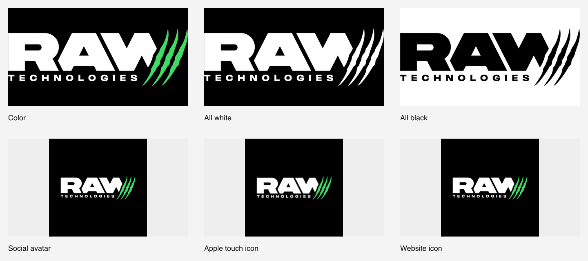

<div align="center">
  <picture>
    <source media="(prefers-color-scheme: dark)" srcset="assets/logos/svg/raw-logo-color.svg">
    
  </picture>

# RAW Technologies LLC · Brand resources

**One complete identity. A small, verified asset kit.**

[](https://github.com/lucasmkrx/raw/actions/workflows/verify.yml)
[](https://github.com/lucasmkrx/raw/releases/latest)
[](LICENSE)

[Download the brand kit](https://github.com/lucasmkrx/raw/releases/latest) · [Asset catalog](docs/ASSET-CATALOG.md) · [Website setup](docs/WEBSITE.md) · [Engineering notes](docs/MAINTENANCE.md)

</div>

---

The official brand resource repository for **RAW Technologies LLC**. Three logo versions, one social profile image, and the essential website icons—generated from a single SVG source and checked automatically.



## Pick an asset

| Asset | SVG | PNG |
| --- | --- | --- |
| Color · original white lettering and green claws | [Vector](assets/logos/svg/raw-logo-color.svg) | [2048px wide](assets/logos/png/raw-logo-color-2048w.png) |
| All white | [Vector](assets/logos/svg/raw-logo-white.svg) | [2048px wide](assets/logos/png/raw-logo-white-2048w.png) |
| All black | [Vector](assets/logos/svg/raw-logo-black.svg) | [2048px wide](assets/logos/png/raw-logo-black-2048w.png) |
| Social profile | — | [1024 × 1024](assets/social/raw-avatar-1024.png) |
| Website icons | [Six-file kit](assets/favicon/) | [Installation guide](docs/WEBSITE.md) |

The complete logo always stays together: RAW lettering, TECHNOLOGIES tagline, and claws. Logo PNGs are transparent. The profile image and icons use the original color logo on black, with space for circular and maskable crops. See the [brand guidelines](docs/BRAND-GUIDELINES.md).

Download a versioned ZIP and its SHA-256 checksum from [Releases](https://github.com/lucasmkrx/raw/releases). The kit includes usage documentation and rights notices. No build tools are needed to use the exported assets.

## How it is maintained

- **One source:** the unchanged [raw.svg](raw.svg) supplies every original path. No fonts or redrawn artwork are required.
- **Repeatable exports:** pinned dependencies, configuration-driven sizes, consistent filenames, and a hashed asset manifest.
- **Automated checks:** GitHub Actions validates the shipped files, then rebuilds and verifies them in an isolated directory.
- **Versioned delivery:** tagged releases, downloadable asset bundles, checksums, and a [changelog](CHANGELOG.md).

Verification covers original SVG geometry, source and export hashes, dimensions, transparency, monochrome colors, circular crops, maskable safe areas, ICO frames, and manifest references. Read the [maintenance guide](docs/MAINTENANCE.md) for implementation and release details.

## Repository layout

```text
raw.svg                  Master logo
brand.config.json        Colors, sizes, and spacing
assets/logos/            Three SVGs and three transparent PNGs
assets/social/           One square profile image
assets/favicon/          SVG, ICO, Apple touch, two web-app icons, manifest
assets/manifest.json     Export inventory and SHA-256 hashes
docs/                    Usage, website setup, licensing, and maintenance
scripts/                 Build, verification, and release packaging
.github/                 CI, code ownership, and contribution templates
```

## Build locally

Use Node.js 22 or later:

```sh
npm ci --ignore-scripts
npm run build
npm run verify
```

The build replaces `assets/`, `docs/previews/`, and the generated catalog. Keep manually maintained files outside those paths. Python 3 is needed only to package a release with `npm run release:bundle`.

## Brand rights and contributions

**Copyright © 2026 RAW Technologies LLC. Brand rights reserved.** The company retains its rights in the RAW artwork and brand identifiers. Public download, forks, and releases do not grant brand-use permission. See [LICENSE](LICENSE), [NOTICE](NOTICE), and the [licensing guide](docs/LICENSING.md).

Build tooling and written documentation are separately licensed under [MIT](LICENSE-CODE), which excludes the brand artwork and grants no trademark rights. Permission requests must be directed to RAW Technologies LLC through an established official company channel; repository issues can request routing but do not authorize use.

For corrections or improvements, see [CONTRIBUTING.md](CONTRIBUTING.md). Original artwork changes require company authorization.
